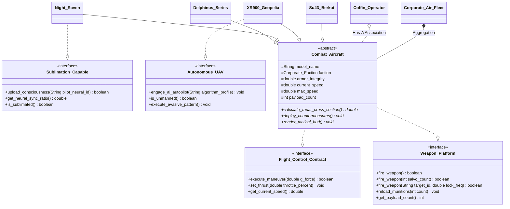

# Assignment 06: Full System Integration - Ace Combat 3 Electrosphere Simulation Engine

## Overview

This module represents a complete capstone synthesis integrating the full continuum of Object-Oriented Programming (OOP) concepts from Modules 01 through 06. The system is set in the canonical universe of **Ace Combat 3: Electrosphere** (2040 Usean Corporate War), modeling high-altitude corporate air warfare, neural COFFIN flight systems, and digital consciousness sublimation.

---

## File Manifest

| Source File | Role | Curriculum Concepts Illustrated |
| :--- | :--- | :--- |
| `Flight_Control_Contract.java` | Interface | Behavioral avionics flight dynamics contract |
| `Weapon_Platform.java` | Interface | Multi-signature offensive weapon firing contract (overloading design) |
| `Sublimation_Capable.java` | Interface | Cyberspace consciousness upload contract (Electrosphere integration) |
| `Autonomous_UAV.java` | Interface | Unmanned AI flight autopilot protocol (Gepetto Project / Nemo AI) |
| `Corporate_Faction.java` | Enumeration | Domain type safety (`GENERAL_RESOURCE`, `NEUCOM_INC`, `UPEO_SARF`, `OUROBOROS`) |
| `Combat_Aircraft.java` | Abstract Class | State encapsulation, invariant guarding, abstract tactical hooks |
| `Delphinus_Series.java` | Concrete Class | Single inheritance from `Combat_Aircraft`, laminar aerodynamics |
| `Night_Raven.java` | Concrete Class | Multilevel inheritance, implements `Sublimation_Capable`, laser cannon |
| `XR900_Geopelia.java` | Concrete Class | Multilevel inheritance, implements `Autonomous_UAV`, 20G uninhibited turn |
| `Su43_Berkut.java` | Concrete Class | Heavy fighter with canard thrust vectoring and dual-band chaff/flares |
| `Coffin_Operator.java` | Entity Class | Object Association (Has-A link to `Combat_Aircraft`), ENSI neural sync |
| `Corporate_Air_Fleet.java` | Aggregation Class | Fixed array (`Combat_Aircraft[]`) + dynamic collection (`ArrayList<Combat_Aircraft>`) |
| `Electrosphere_Demo.java` | Simulation Driver | Dr. Simon Orestes Cohen testbed; automated telemetry + interactive CLI (`-i`) |

---

## Architecture & Class Diagram



---

## Synthesis of OOP Principles (Modules 01 - 06)

### 1. Module 01: Core OOP Basics & Instantiation
- Distinct airframe entities (`Delphinus_Series`, `Night_Raven`, `Su43_Berkut`, `XR900_Geopelia`) are instantiated on the JVM heap with dedicated state parameters (speed, payload, aerodynamics).

### 2. Module 02: Encapsulation & Invariant Enforcement
- Attributes (`armor_integrity`, `current_speed`, `payload_count`) are marked `protected` or `private`.
- Mutators strictly enforce physical class invariants:
  - Throttle values outside $[0.0, 100.0]$ are clamped to prevent negative velocities or exceeding `max_speed`.
  - Exceeding airframe G-force thresholds causes structural damage to `armor_integrity`.
  - Firing weapons with zero payload returns `false` without decrementing into negative ammunition.

### 3. Module 03: Object Association (Has-A Relationship)
- `Coffin_Operator` models an independent pilot entity maintaining a direct reference to a `Combat_Aircraft`.
- The association enables neural link synchronization (`sync_neural_link()`), checking pilot neuro-compatibility against airframe specifications.

### 4. Module 04: Fixed Arrays vs. Dynamic Collections
- `Corporate_Air_Fleet` manages aircraft using two distinct memory structures:
  - **Fixed-Size Array (`Combat_Aircraft[] ready_hangar`)**: Models immediate launch-ready aircraft slots with contiguous memory layout and $O(1)$ indexed lookup.
  - **Dynamic List (`ArrayList<Combat_Aircraft> reserve_reinforcements`)**: Models dynamically scalable reinforcement reserves that expand automatically.

### 5. Module 05: Inheritance & Polymorphism
- **Subtyping Trees**: `Delphinus_Series`, `Night_Raven`, `XR900_Geopelia`, and `Su43_Berkut` extend `Combat_Aircraft`, chaining constructors via `super()`.
- **Runtime Dynamic Dispatch (vtable)**: Iterating across a fleet of `Combat_Aircraft` references invokes each subtype's specialized `deploy_countermeasures()` and `render_tactical_hud()` methods via late binding.
- **Compile-Time Method Overloading**: In `Weapon_Platform` and `Combat_Aircraft`, `fire_weapon()` is overloaded with three distinct signatures:
  1. Default single-munition pulse burst.
  2. Multi-missile salvo: `fire_weapon(int salvo_count)`.
  3. Radar-guided long-range tracking: `fire_weapon(String target_id, double lock_frequency)`.

### 6. Module 06: Abstract Classes vs. Interfaces
- **Abstract Base (`Combat_Aircraft`)**: Implements shared physical state and common flight mechanics while declaring abstract hooks for airframe-specific radar cross-sections and countermeasure deployment.
- **Interfaces (`Sublimation_Capable`, `Autonomous_UAV`)**: Decouple specialized behaviors. Only `Night_Raven` implements consciousness uploading, and only `XR900_Geopelia` implements unmanned AI autopilot protocols.

---

## Compilation and Execution

```powershell
# Compile all sources in this directory
javac 06/*.java

# Run automated simulation (Dr. Simon Orestes Cohen Sandbox Benchmark)
java -cp 06 Electrosphere_Demo

# Run interactive COFFIN mission console (via Scanner)
java -cp 06 Electrosphere_Demo -i
```

---

## Terminal Execution Output

### Automated Simulation Mode
```
[NEUCOM AERO WING] Stationed R-101 Delphinus #1 in hangar slot [0].
[NEUCOM AERO WING] Stationed XR-900 Geopelia in hangar slot [1].
[NEUCOM AERO WING] Added R-102 Delphinus #2 to reserve depot. (Reserve count: 1)
[GR DEFENSE DIVISION] Stationed Su-43 Berkut in hangar slot [0].
[GR DEFENSE DIVISION] Stationed X-49 Night Raven in hangar slot [1].
==================================================
   ELECTROSPHERE TACTICAL SIMULATION ENGINE (2040) 
   Dr. Simon Orestes Cohen Sandbox Environment    
==================================================

>>> Initializing COFFIN Neural Operators...
[COFFIN] Operator Rena Hirose assigned to airframe R-101 Delphinus #1
[COFFIN] ENSI neural synchronization established for Rena Hirose (Sync: 98.0%) with R-101 Delphinus #1

>>> Executing Weapon Platform Overloading Protocol...
-- Overload 1: Default Weapon Discharge --
[R-101 Delphinus #1] Discharged standard pulse burst. Remaining payload: 47

-- Overload 2: Multi-Missile Salvo --
[R-101 Delphinus #1] Discharged 4-missile salvo! Remaining payload: 43

-- Overload 3: Radar-Guided Long-Range Lock --
[R-101 Delphinus #1] Radar missile locked on target DISION-DEADCOPY-ALPHA at 18.5 GHz! Fired.

>>> Verifying Sublimation Protocol on X-49 Night Raven...
Initial Sublimation Status: false
[X-49 Night Raven] Consciousness sublimation verified: Entity [ABYSSAL-DISION-001] bound to Opto-Neuron core.
Post-Upload Sublimation Status: true
Neural Synchrony: 99.80%
[X-49 Night Raven] DISCHARGED HIGH-OUTPUT LASER CANNON (35.0 MW)! Capacitor: 65.0 MW

>>> Verifying Autonomous UAV Protocol on XR-900 Geopelia...
Is Unmanned Craft: true
[XR-900 Geopelia] Autopilot engaged with profile: NEMO-INTERCEPT-MATRIX-ALPHA
[XR-900 Geopelia] Executing unmanned super-maneuverability split-S (20G uninhibited turn)!

>>> Scrambling Corporate Air Fleets (Polymorphic vtable dispatch)...
==================================================
SCRAMBLING SORTIE: NEUCOM AERO WING // NEUCOM_INC
==================================================

-- Launching Hangar Slot [0]: R-101 Delphinus #1 --
[R-101 Delphinus #1] Deploying electronic aero-shield dispersion chaff and nano-jammers.
--------------------------------------------------
NEUCOM ELECTROSPHERE HUD // R-101 Delphinus #1
Faction   : NEUCOM_INC
Airspeed  : 2790.0 / 3100.0 km/h
Armor     : 100.0%
Laminar   : 0.85
Munitions : 42 units ready
--------------------------------------------------

-- Launching Hangar Slot [1]: XR-900 Geopelia --
[XR-900 Geopelia] AI automated laser-defensive point matrix activated.
--------------------------------------------------
GEPETTO AUTONOMOUS TELEMETRY // XR-900 Geopelia
Faction     : NEUCOM_INC
Airspeed    : 3420.0 / 3800.0 km/h
Armor       : 100.0%
AI Profile  : NEMO-INTERCEPT-MATRIX-ALPHA
Unmanned    : true
Munitions   : 60 units ready
--------------------------------------------------
==================================================
SCRAMBLING SORTIE: GR DEFENSE DIVISION // GENERAL_RESOURCE
==================================================

-- Launching Hangar Slot [0]: Su-43 Berkut --
[Su-43 Berkut] Dispensing high-temperature magnesium flares and dual-band chaff corridors.
--------------------------------------------------
GENERAL RESOURCE COFFIN-2 HUD // Su-43 Berkut
Faction     : GENERAL_RESOURCE
Airspeed    : 2610.0 / 2900.0 km/h
Armor       : 100.0%
Canards     : ACTIVE VECTORING
Munitions   : 40 units ready
--------------------------------------------------

-- Launching Hangar Slot [1]: X-49 Night Raven --
[X-49 Night Raven] Activating Opto-Neuron full-spectrum radar/optical scrambling field.
--------------------------------------------------
OUROBOROS CYBERSPACE COCKPIT // X-49 Night Raven
Faction     : OUROBOROS
Airspeed    : 3780.0 / 4200.0 km/h
Armor       : 100.0%
Laser Cap   : 65.0 MW
Sublimation : ACTIVE (ABYSSAL-DISION-001 // 99.8%)
--------------------------------------------------

==================================================
SIMULATION METRICS SUMMARY
Neucom Fleet Firepower Rating : 1580.0
GR Fleet Firepower Rating     : 1120.0
==================================================
```
