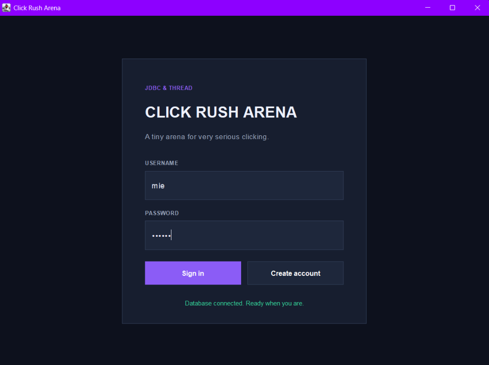
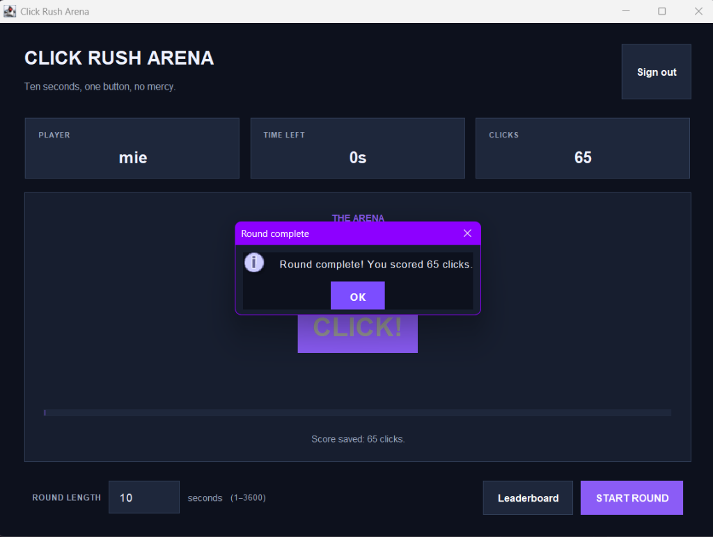
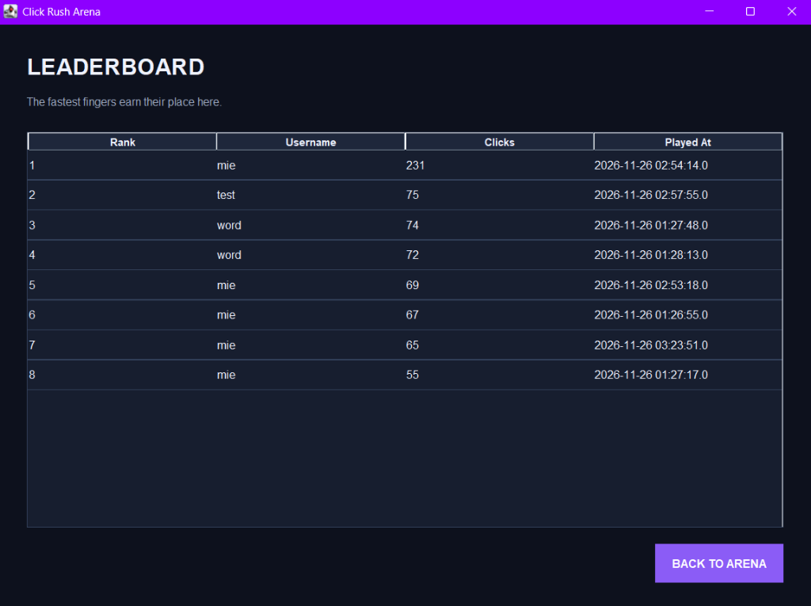

# 08 - Thread and Database in Java (Click Rush App)

Case study implementation for **5A - Java Coding Practice - Thread and Database - 2026**, demonstrating non-blocking Swing UI updates backed by a MySQL DAO on a background thread.

## Requirements Coverage

1. **Database & DAO (`DB_Helper.java`)**
   - Uses `lib/mysql-connector-j-9.5.0.jar` for MySQL connectivity.
   - Implements full CRUD operations using `Connection`, `PreparedStatement`, explicit transactions (`setAutoCommit(false)`, `commit()`, `rollback()`), and `ResultSet` mapping.
2. **Thread -> `invokeLater` -> UI Pattern (`Click_Rush_App.java`)**
   - Database queries and writes execute on background worker threads so the Swing Event Dispatch Thread (EDT) remains responsive.
   - Results and status updates are marshaled back to the UI via `SwingUtilities.invokeLater(...)`.
3. **Responsive GUI Feedback**
   - Click handlers immediately disable action buttons and update the status label (e.g., `"Saving..."`) before dispatching the background database task, then re-enable controls once the EDT callback completes.

## Project Structure

```text
08/
├── lib/
│   └── mysql-connector-j-9.5.0.jar
├── Click_Rush_App.java
├── DB_Helper.java
└── README.md
```

## Build and Run

Compile and run from the `08/` directory:

```powershell
javac --release 21 -cp "lib/mysql-connector-j-9.5.0.jar" Click_Rush_App.java DB_Helper.java
java -cp ".;lib/mysql-connector-j-9.5.0.jar" Click_Rush_App
```

## Screenshots

### Sign In / Account Creation


### Arena & Round Complete


### Leaderboard

